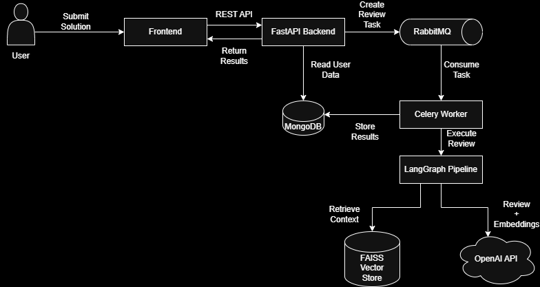
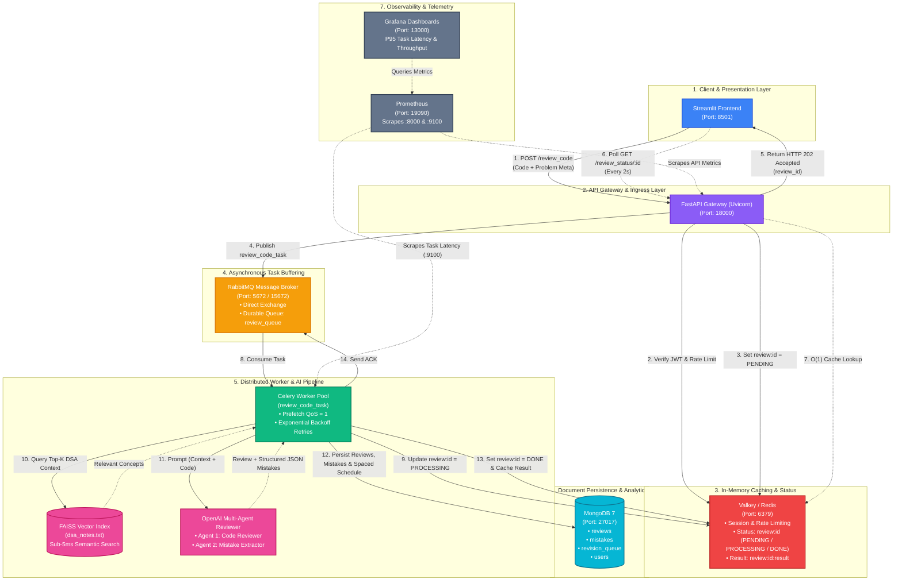

# 🚀 CodeMentor AI — AI-Powered DSA Learning with Spaced Repetition

CodeMentor AI is an intelligent system that reviews LeetCode solutions, detects mistake patterns, and uses spaced repetition to help users **stop repeating the same errors**.

Instead of just telling whether a solution is correct, CodeMentor acts like a **personal DSA mentor** that remembers your weaknesses and forces you to revise them.

---

## ✨ What Problem Does This Solve?

While practicing DSA:

* You repeat the same mistakes across problems
* There is no memory of past errors
* Feedback is shallow (WA/TLE/AC)
* No structured revision of weak patterns

**CodeMentor AI fixes this** by:

* Reviewing code with an LLM + RAG
* Detecting mistake patterns
* Storing them
* Scheduling revisions using spaced repetition
* Providing flashcards, redo lists, and heatmaps

---

## 🧠 High-Level Architecture


## Architecture

---

## ⚙️ Tech Stack (and why)

| Tech                 | Purpose                                 |
| -------------------- | --------------------------------------- |
| FastAPI              | High-performance API for async workflow |
| Streamlit            | Simple interactive frontend             |
| RabbitMQ             | Reliable message broker for reviews     |
| Celery               | Background task processing              |
| Valkey (Redis)       | Review status cache for polling         |
| MongoDB              | Mistake history, revision scheduling    |
| FAISS                | Semantic retrieval over DSA notes (RAG) |
| OpenAI               | Code review agent                       |
| Prometheus + Grafana | Production-grade observability          |
| Docker Compose       | Multi-service reproducible environment  |


---

## 🔁 Review Flow (Async)

1. User submits code
2. FastAPI generates `review_id`
3. Task pushed to RabbitMQ
4. Celery worker processes review (RAG + LLM)
5. Mistake stored in MongoDB
6. Result stored in Redis
7. Frontend polls `/review_status` until done

This ensures:

* Non-blocking API
* Scalable review pipeline
* Clean separation of concerns

---

## 📊 Observability (Real Metrics)

The system tracks:

* API request rate
* API p95 latency per endpoint
* Reviews processed per second
* Review processing time (p95)

These are visualized in Grafana.

> Add your Grafana screenshot here

---

## 🧩 Features

* AI code review using RAG + LLM
* Mistake pattern detection
* Spaced repetition revision queue
* Flashcards from past mistakes
* Topic heatmap of weaknesses
* Redo list for problematic questions
* Fully asynchronous processing
* Observable system health

---

## ▶️ How to Run Locally

### Prerequisites

* Docker
* OpenAI API Key in `.env`

### Start the system

```bash
docker-compose up --build
```

### Access

| Service      | URL                                              |
| ------------ | ------------------------------------------------ |
| Streamlit UI | [http://localhost:8501](http://localhost:8501)   |
| FastAPI      | [http://localhost:18000](http://localhost:18000) |
| Prometheus   | [http://localhost:19090](http://localhost:19090) |
| Grafana      | [http://localhost:13000](http://localhost:13000) |

---

## 📈 Scaling Strategy

To scale reviews:

* Add more Celery workers
* RabbitMQ distributes tasks automatically
* FastAPI remains stateless
* No code changes required

---

## 🛡️ Reliability

* Celery retries with backoff
* Redis for idempotent status tracking
* Queue prevents request loss
* Structured logging
* Metrics for detecting bottlenecks

---

## 📚 System Design

See detailed design here:
👉 `SYSTEM_DESIGN.md`

---

## 🎯 Key Learnings

This project demonstrates:

* Designing async AI systems
* Queue-based architecture
* Observability in microservices
* RAG + LLM integration
* Scalable backend design


